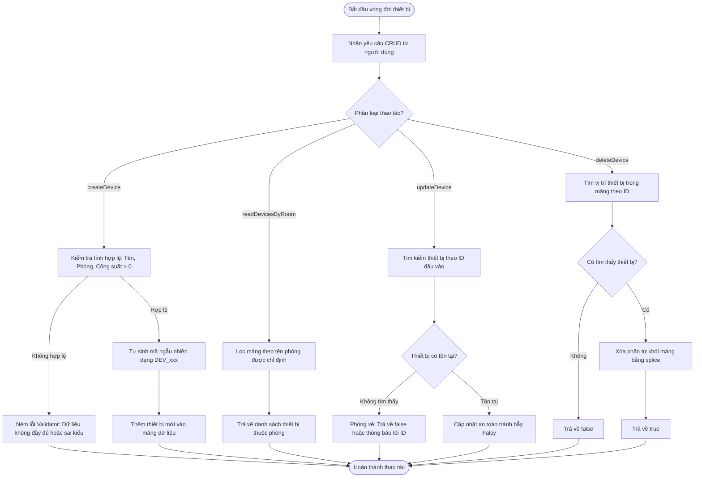

# BÁO CÁO BÀI TẬP: XÂY DỰNG KIẾN TRÚC MODULE HÀM CRUD QUẢN TRỊ THIẾT BỊ SMART HOME

> 👤 **Học viên:** Hoàng Công Dũng | **Mã SV:** PTIT-HCM-009
> 🏫 **Môn học:** it103b-rl-HoangCongDung

---

## 📊 Sơ đồ thiết kế hệ thống (Flowchart)

> 💡 *Sơ đồ dưới đây được render tự động trực tiếp trên GitHub bằng Mermaid. Bạn cũng có thể tải file **`bt2.drawio`** trong repository này để mở và chỉnh sửa trực tiếp trên [Draw.io (diagrams.net)](https://app.diagrams.net).* 

---

## 1. Mục tiêu và Bối cảnh bài toán

Bài tập yêu cầu xây dựng bộ thư viện hàm CRUD chuẩn ES6+ hoàn chỉnh nhằm quản lý các thiết bị điện trong một căn hộ thông minh. Yêu cầu đặt ra là phải đảm bảo tính đóng gói mã nguồn, kiểm tra nghiêm ngặt dữ liệu đầu vào thông qua hàm kiểm chuẩn (Validator Function) và phòng vệ kỹ lưỡng các lỗi logic thường gặp như giá trị Falsy khi cập nhật trạng thái thiết bị.

- Sử dụng hoàn toàn cú pháp Arrow Function của ES6+.
- Tự động sinh mã thiết bị theo định dạng chuẩn 'DEV_xxx'.
- Xử lý phòng vệ triệt để các trường hợp ID không tồn tại trong hệ thống.

## 2. Chi tiết cài đặt mã nguồn và Quy tắc nghiệp vụ

Toàn bộ source code được viết trong file 'solution_ex7.js'. Các hàm CRUD được thiết kế độc lập, nhận vào mảng thiết bị hiện tại và thực hiện thay đổi hoặc trả về dữ liệu mới mà không làm hỏng dữ liệu gốc ngoài ý muốn.

- Hàm 'createDevice': Kiểm tra bắt buộc có tên, phòng và công suất phải lớn hơn 0.
- Hàm 'readDevicesByRoom': Lọc và trả về danh sách thiết bị chính xác theo tên phòng.
- Hàm 'updateDevice': Sử dụng kỹ thuật kiểm tra tồn tại ID và cập nhật an toàn tránh ghi đè sai các giá trị số 0 hoặc boolean false.
- Hàm 'deleteDevice': Tìm kiếm vị trí thiết bị và gỡ bỏ khỏi mảng, trả về boolean 'true' hoặc 'false'.

---

## 📁 Danh sách tệp tin nộp bài trong Repository
- 📝 `bt2.docx`: Báo cáo tài liệu phân tích nghiệp vụ hoàn chỉnh.
- 🎨 `bt2.drawio`: File thiết kế sơ đồ chuẩn theo quy định đề bài (mở trực tiếp bằng [Draw.io](https://app.diagrams.net) hoặc Lucidchart).
- 💻 `solution_ex7.js`: Mã nguồn chương trình.
